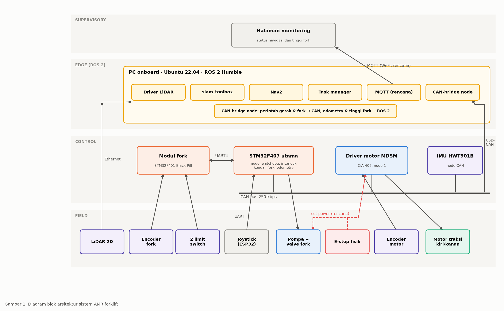
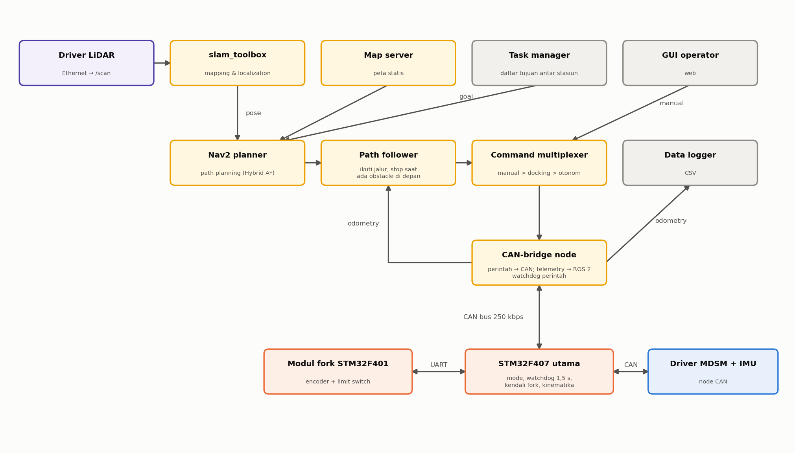
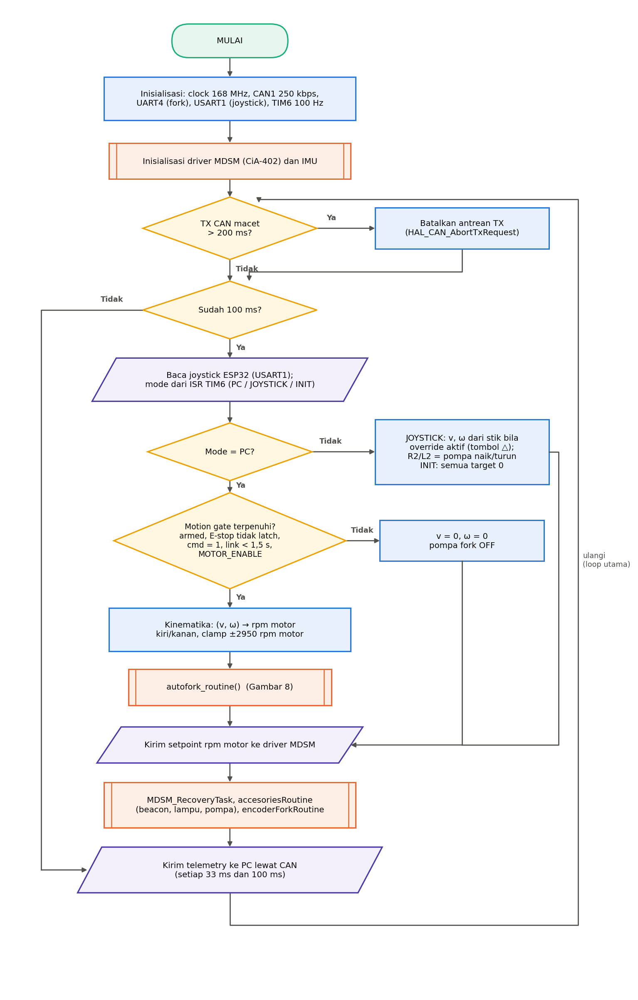
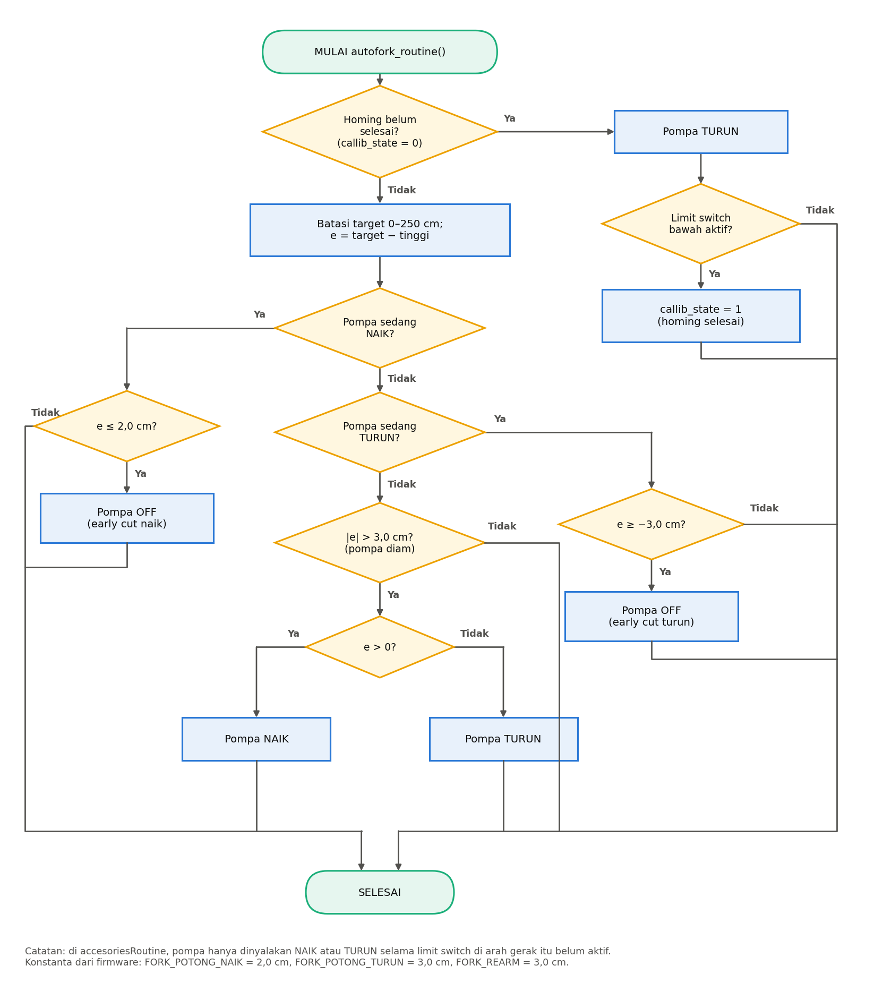

# PjBL Semester 7 — Week 4

**Pengembangan Sistem Navigasi Otonom dan Kendali Ketinggian Fork pada AMR Forklift Berbasis ROS 2**
Mitra industri: PT Integrasi Bisnis Eksekutif

## Daftar Isi

- [Logbook Minggu 4](#logbook-minggu-4)
- [Detailed Engineering Design (DED)](#detailed-engineering-design-ded)
- [Desain Hardware](#desain-hardware)
- [Desain Software](#desain-software)
- [Flowchart dan Logika Program](#flowchart-dan-logika-program)
- [Rencana Pengujian](#rencana-pengujian)
- [Temuan Desain](#temuan-desain)
- [Rencana Selanjutnya](#rencana-selanjutnya)
- [Referensi](#referensi)

---

## Logbook Minggu 4

Periode 19/10/2026 s.d. 23/10/2026 (tahap Perancangan), sesuai logbook individu DTEO ITS.

- Sel, 20/10 = Verifikasi peta ID CAN dan format data dari firmware (3 jam); memperbarui blok diagram kendali gerak, kendali fork, dan arsitektur sistem sesuai firmware (2 jam)
- Jum, 23/10 = Menyusun DED bagian 04 (4 jam), bagian 05 (3 jam), dan bagian 06–10 (4 jam)
- Total = 16 jam

**Target minggu ini:** (1) verifikasi format pesan CAN dan arsitektur sistem terhadap firmware forklift; (2) DED bagian 04–10 tersusun sebagai dokumen lengkap untuk review desain (M2); (3) driver LiDAR (/scan) dan kalibrasi fork titik 200 cm.

**Kendala dan solusi:**

1. Pekerjaan hardware minggu 4 (verifikasi frame CAN dengan candump di forklift, driver LiDAR /scan, kalibrasi fork titik 200 cm, perbaikan label limit switch) belum dikerjakan karena minggu ini difokuskan pada DED. Solusi: dikerjakan di minggu 5 sebelum review desain M2.
2. Wiring E-stop dan driver pompa belum terdokumentasi, dan skematik board STM32F407 belum ada. Solusi: telusuri wiring panel forklift dan lampirkan di DED.
3. Watchdog firmware 1,5 s melebihi target SP-09 (≤ 1 s). Solusi: timeout watchdog firmware diturunkan ke ≤ 1 s, lalu diverifikasi pada T-05.
4. Power budget belum dapat dihitung karena arus pompa, PC, dan elektronik belum diukur. Solusi: diukur saat kalibrasi minggu 6–7.

**Capaian target:** Sebagian — target (1) dan (2) tercapai; (3) belum.

Materi minggu sebelumnya:

- [Branch week1](https://github.com/syawxyz/PjBL-Semester7/tree/week1) = Diskusi dengan mitra, Nav2, RViz, algoritma A*, arsitektur dan skematik modul fork
- [Branch week2](https://github.com/syawxyz/PjBL-Semester7/tree/week2) = Simulasi Nav2 dan SLAM, Theta*, perakitan dan kalibrasi modul fork, CAN bus dasar dan CAN-bridge node, TF tree dan URDF, rosbag2
- [Branch week3](https://github.com/syawxyz/PjBL-Semester7/tree/week3) = CAN lanjutan dan data CAN forklift, FAST-LIO dan DLIO, Hybrid A*, desain kontrol forklift, draf DED bagian 01–03

---

## Detailed Engineering Design (DED)

DED adalah luaran L2 di Project Charter dan menjadi bahan review desain (milestone M2, minggu 5). Dokumen disusun dari template departemen dengan nomor `PJBL7-K1-DED`, revisi 00, status DRAF, sebanyak 18 halaman.

- 01 Pendahuluan = Ringkasan proyek, tujuan dokumen, ruang lingkup desain, definisi dan singkatan
- 02 Kebutuhan Sistem = Kebutuhan fungsional FR-01 s.d. FR-10 dan non-fungsional NFR-01 s.d. NFR-08, dipetakan ke SP-01 s.d. SP-09
- 03 Arsitektur Sistem = Diagram blok berlapis dan deskripsi subsistem SS-01 s.d. SS-06
- 04 Desain Hardware = Alur sinyal, BOM, daftar I/O, skematik dan wiring, power budget, tata letak panel
- 05 Desain Software = Arsitektur software ROS 2, daftar modul, protokol CAN dan UART, struktur data
- 06 Flowchart dan Logika Program = Flowchart program utama, flowchart kendali fork, state machine
- 07 Rencana Pengujian dan Verifikasi = Uji T-01 s.d. T-06
- 08 Keselamatan dan Standar Acuan = PUIL 2011, IEC 61131-3, IEC 60529, K3 pengujian, ISO 3691-4 sebagai acuan
- 09 Daftar Lampiran = Skematik, datasheet, kode program, gambar mekanik
- 10 Review Desain dan Persetujuan = Checklist review (diisi dosen pembimbing)

Seluruh data teknis diambil dari kode firmware STM32F407, firmware modul fork STM32F401, dan node ROS 2 forklift milik mitra. Rincian yang bersifat internal (peta perintah CAN, alamat jaringan, dan parameter navigasi) hanya dicantumkan di dokumen DED.

---

## Desain Hardware

### Komponen Utama

- Kontroler utama = STM32F407VET6, Cortex-M4 168 MHz
- Modul fork = STM32F401CCU6 Black Pill dengan encoder incremental 600 PPR dan dua limit switch
- Driver motor = MDSM25B96G-2, dual channel, CANopen CiA-402 node 1, arus rated 24 A
- Motor traksi = TZ09-D09 (2 unit), 2950 rpm, gear ratio 24, roda Ø210 mm
- IMU = HWT901B versi CAN
- LiDAR = Autonics LSC, FOV 270°, 15 Hz, Ethernet (jarak maksimum dari datasheet belum diverifikasi di lapangan)
- PC onboard = Intel NUC 11 (Core i3-1115G4, RAM 16 GB), Ubuntu 22.04, ROS 2 Humble
- Baterai = Sistem 48 V

### I/O Utama STM32F407

- CAN1 = PD0 RX / PD1 TX, 250 kbps, ke PC, driver MDSM, dan IMU
- UART4 = PA0 TX / PA1 RX, 115200 bps, ke modul fork
- USART1 = PA9 TX / PA10 RX, 115200 bps, ke receiver joystick ESP32
- UP_PUMP = PE1, pompa fork naik, aktif HIGH
- DOWN_PUMP = PC13, pompa/valve fork turun, aktif HIGH
- Tower lamp = R PC5, G PA4, Y PC0, buzzer PE6

### Geometri Forklift

- Panjang total = 1,95 m; lebar = 1,10 m
- Fork = 0,80 m, berada di sisi belakang
- LiDAR = 0,35 m di depan poros roda penggerak, tinggi 0,15 m
- Jarak antar roda = 0,65 m; jari-jari roda = 0,105 m

---

## Desain Software

- Firmware = STM32F407 (kontroler utama) dan STM32F401 (modul fork), bahasa C dengan STM32 HAL
- Backend = PC onboard dengan ROS 2 Humble (Python): CAN-bridge node, slam_toolbox (mapping dan localization), Nav2 planner (Hybrid A*), path follower, command multiplexer, data logger
- Frontend / HMI = GUI web operator

### Modul Utama

- autofork_routine() = Kendali on/off fork dengan early cut 2,0 cm (naik) dan 3,0 cm (turun), aktif lagi jika error > 3,0 cm
- Kinematika dan driver = Mengubah (v, ω) menjadi rpm motor kiri/kanan (gear ratio 24), dibatasi ±2950 rpm motor (≈ ±123 rpm roda), dengan stall recovery
- Arbitrase mode dan watchdog = Memilih mode PC, JOYSTICK, atau INIT; link PC dianggap timeout setelah 1,5 s
- CAN-bridge node = Satu-satunya node yang menggerakkan robot; mengubah /cmd_vel_agv dan /cmd_fork menjadi frame CAN, dengan watchdog perintah
- Nav2 planner = Path planning Hybrid A* yang memperhitungkan radius belok forklift
- Path follower = Mengikuti jalur; stop jika ada obstacle di depan forklift
- Command multiplexer = Memilih perintah dengan prioritas manual, lalu docking, lalu otonom

Ringkasan data CAN ada di [branch week3](https://github.com/syawxyz/PjBL-Semester7/tree/week3#data-can-forklift).

---

## Flowchart dan Logika Program

### Program Utama STM32F407

Setelah inisialisasi, firmware masuk ke loop utama. Setiap 100 ms firmware membaca joystick dan mode hasil arbitrase dari interrupt TIM6 (10 ms). Pada mode PC, forklift hanya bergerak jika motion gate terpenuhi: sudah di-arm, E-stop tidak latch, perintah jalan aktif, perintah PC belum lebih tua dari 1,5 s, dan kedua channel driver aktif. Jika salah satu syarat gagal, setpoint kecepatan dibuat nol dan pompa fork dimatikan.

### Kendali Ketinggian Fork

- Homing = Hanya berjalan di mode PC: fork diturunkan sampai limit switch bawah aktif; modul fork me-reset count ke nol setiap kali limit switch bawah tertekan
- Naik = Pompa dimatikan saat error ≤ 2,0 cm (early cut) untuk mengimbangi overrun
- Turun = Pompa dimatikan saat error ≥ −3,0 cm (early cut)
- Diam = Pompa dinyalakan lagi hanya jika |error| > 3,0 cm
- Interlock = Pompa naik/turun hanya menyala selama limit switch di arah itu belum aktif

### State Machine

- INIT = Saat boot, atau tidak ada joystick maupun PC yang aktif; semua target nol
- JOYSTICK = Frame joystick valid; override = 0 setelah boot (lampu kuning), jadi v dan ω baru mengikuti stik setelah tombol segitiga ditekan; tombol R2/L2 menggerakkan fork tanpa perlu override
- PC = Perintah gerak dari PC masih baru (< 1,5 s), sudah di-arm, tanpa override; mengikuti perintah gerak dan target fork selama motion gate terpenuhi
- E-STOP (latch) = E-stop software dari PC; perintah gerak dari PC ditahan sampai operator melepas latch, sedangkan joystick tetap bisa dipakai

---

## Rencana Pengujian

- T-01 (SP-01, SP-02) = Rekam rosbag 60 menit dan uji odometry lurus 5 m serta putar 360°
- T-02 (SP-03, SP-04) = Ukur tinggi fork di 6 titik dari posisi terendah (≈ 18 cm) sampai 200 cm (naik dan turun) dan 10 target acak lewat /cmd_fork
- T-03 (SP-01) = Cocokkan frame CAN hasil candump dengan peta ID, cek riwayat task manager dan telemetry selama 10 menit
- T-04 (SP-05, SP-06, SP-07) = Localization di 5 titik referensi, 20 percobaan navigasi point-to-point, 10 siklus A → fork naik → B → fork turun
- T-05 (SP-08, SP-09) = Uji E-stop, link terputus, kecepatan, dan 50 perintah manual lewat remote
- T-06 (security) = Perintah gerak tanpa arming, tanpa deadman, dan setelah E-stop tidak boleh menggerakkan forklift

Status saat ini: T-02 sebagian (kalibrasi minggu 2 pada 18–150 cm, residu maksimal 0,8 cm); uji lainnya belum dilakukan.

---

## Temuan Desain

Hal-hal berikut ditemukan saat menyusun DED dan perlu ditindaklanjuti sebelum atau saat pengujian:

- Skematik = Skematik board STM32F407 belum tersedia; baru modul fork yang lengkap
- Power budget = Baru motor traksi yang diketahui (batas arus driver 16,7 A per channel pada 48 V); pompa, PC, dan elektronik belum diukur
- Limit switch = Firmware memakai PB14 = atas dan PB15 = bawah; label di skematik perlu disesuaikan
- Firmware terpasang = Firmware terakhir di-flash 24/8, sedangkan logika early cut di kode bertanggal 26/8; firmware perlu di-flash ulang sebelum uji fork

Temuan yang berkaitan dengan keselamatan dicatat di DED bagian 07–08 dan dibahas saat review desain.

---

## Rencana Selanjutnya

Minggu 5, sesuai rencana di logbook minggu 4:

- Review desain DED (M2) dengan dosen pembimbing
- Verifikasi frame CAN dengan candump di forklift
- Driver LiDAR: /scan tampil di RViz
- Kalibrasi fork titik 200 cm dan arah turun
- Perbaikan label limit switch di skematik
- Screenshot GUI operator dan dokumentasi wiring pompa serta E-stop
- Pengajuan charter (M1) jika belum disahkan

---

## Referensi

- [Dokumentasi Nav2](https://docs.nav2.org/)
- [Nav2 Smac Planner](https://docs.nav2.org/configuration/packages/configuring-smac-planner.html)
- [slam_toolbox](https://github.com/SteveMacenski/slam_toolbox)
- [ros2_socketcan](https://github.com/autowarefoundation/ros2_socketcan)
- [SocketCAN (dokumentasi kernel Linux)](https://docs.kernel.org/networking/can.html)
- CiA 402: CANopen device profile for drives and motion control
- ISO 3691-4: Industrial trucks — Safety requirements and verification — Part 4: Driverless industrial trucks and their systems
- PUIL 2011: Persyaratan Umum Instalasi Listrik
