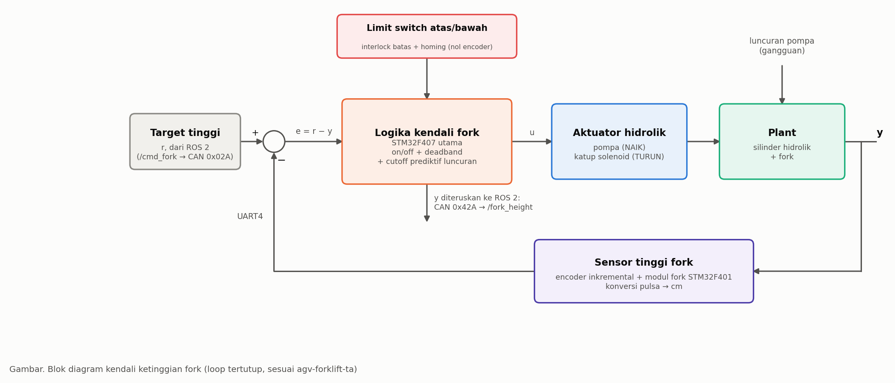
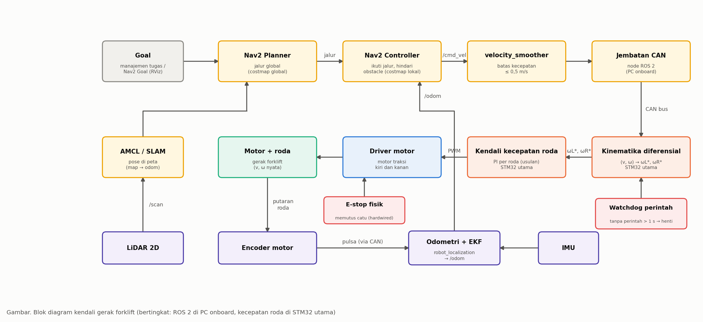

# PjBL Semester 7 — Week 3

**Pengembangan Sistem Navigasi Otonom dan Kendali Ketinggian Fork pada AMR Forklift Berbasis ROS 2**
Mitra industri: PT Integrasi Bisnis Eksekutif

## Daftar Isi

- [Logbook Minggu 3](#logbook-minggu-3)
- [CAN Lanjutan: ros2_socketcan, Error Bus, dan Log CAN](#can-lanjutan-ros2_socketcan-error-bus-dan-log-can)
- [LIO: FAST-LIO dan DLIO](#lio-fast-lio-dan-dlio)
- [Hybrid A*](#hybrid-a)
- [Desain Kontrol Forklift](#desain-kontrol-forklift)
- [Arsitektur Sistem dan Draf DED](#arsitektur-sistem-dan-draf-ded)
- [Rencana Selanjutnya](#rencana-selanjutnya)
- [Referensi](#referensi)

---

## Logbook Minggu 3

Periode 12/10/2026 s.d. 16/10/2026 (tahap Perancangan), sesuai logbook individu DTEO ITS.

- Sen, 12/10 = Tidak ada kegiatan proyek
- Sel, 13/10 = Mempelajari CAN bus dan bridge CAN–ROS 2: `ros2_socketcan`, penanganan error bus, log CAN (5 jam)
- Rab, 14/10 = Mempelajari navigasi: FAST-LIO, DLIO, dan Hybrid A* (5 jam)
- Kam, 15/10 = Merancang kontrol forklift: blok diagram kendali ketinggian fork dan kendali gerak (5 jam)
- Jum, 16/10 = Menyusun draf DED bagian 01–03: pendahuluan, kebutuhan sistem, arsitektur sistem (5 jam)
- Total = 20 jam

**Target minggu ini:** (1) memahami bridge CAN–ROS 2 serta navigasi FAST-LIO, DLIO, dan Hybrid A*; (2) blok diagram kontrol forklift (kendali ketinggian fork dan kendali gerak) selesai; (3) draf DED bagian 01–03 tersusun.

**Kendala dan solusi:**

1. Format pesan CAN STM32 utama belum diketahui, sehingga decoder `ros2_socketcan` masih memakai ID contoh. Solusi: peta ID dan format data diambil dari repositori proyek AGV `agv-forklift-ta` (`agv_can.py`, sumber firmware `can_pc.h`/`can_pc.c`); lihat [Peta ID CAN Forklift](#peta-id-can-forklift).
2. FAST-LIO dan DLIO membutuhkan LiDAR 3D, sedangkan forklift memakai LiDAR 2D. Solusi: FAST-LIO dan DLIO tidak dipakai; navigasi tetap memakai slam_toolbox dan AMCL dengan odometri roda + giro IMU.
3. Kendali kecepatan per roda semula diasumsikan berupa PI di STM32 utama. Solusi: driver motor MDSM (CiA-402, Profile Velocity Mode) sudah mengatur kecepatan sendiri, sehingga STM32F407 cukup mengirim setpoint kecepatan (rpm) tiap roda; blok diagram kendali gerak dan arsitektur sistem diperbarui.
4. Nilai deadband dan luncuran pompa hidrolik untuk kendali fork belum diketahui. Solusi: identifikasi dari uji step fork di minggu 6–7.

**Capaian target:** Tercapai — target (1), (2), dan (3) tercapai.

**Progres kumulatif:**

- Minggu 1 = 4,2% (2 dari 3 target)
- Minggu 2 = 8,3% (2 dari 3 target)
- Minggu 3 = 14,6% (3 dari 3 target)
- Rencana linear sampai minggu 3 = 18,75%

Cara hitung: tiap minggu bernilai 100% / 16 = 6,25%, dikali bagian target mingguan yang tercapai. Selisih terhadap rencana terutama karena charter (M1) belum disahkan.

Materi minggu sebelumnya:

- [Branch week1](https://github.com/syawxyz/PjBL-Semester7/tree/week1) = Diskusi dengan mitra, Nav2, RViz, algoritma A*, arsitektur dan skematik modul fork
- [Branch week2](https://github.com/syawxyz/PjBL-Semester7/tree/week2) = Simulasi Nav2 dan SLAM, Theta*, perakitan dan kalibrasi modul fork, CAN bus dasar dan contoh node jembatan CAN, TF tree dan URDF, rosbag2

---

## CAN Lanjutan: ros2_socketcan, Error Bus, dan Log CAN

Dasar CAN, SocketCAN, dan contoh node jembatan CAN dengan python-can sudah dibahas di [minggu 2](https://github.com/syawxyz/PjBL-Semester7/tree/week2#can-bus-dan-socketcan). Minggu ini membahas paket resmi `ros2_socketcan`, cara membaca kondisi error bus, dan cara merekam lalu memutar ulang lalu lintas CAN.

### Paket ros2_socketcan

`ros2_socketcan` menyediakan dua node: **receiver** (bus CAN → topic) dan **sender** (topic → bus CAN). Isi frame dibawa oleh message `can_msgs/msg/Frame`.

```bash
sudo apt install ros-humble-ros2-socketcan

# Receiver + sender sekaligus
ros2 launch ros2_socketcan socket_can_bridge.launch.xml interface:=can0
```

- `/from_can_bus` (`can_msgs/msg/Frame`) = Frame yang diterima dari bus
- `/to_can_bus` (`can_msgs/msg/Frame`) = Frame yang akan dikirim ke bus
- Field `can_msgs/msg/Frame` = `header`, `id`, `is_rtr`, `is_extended`, `is_error`, `dlc`, `data` (`uint8[8]`)
- Parameter penting = `interface` (bawaan `can0`), `filters` (bawaan `0:0`, artinya semua ID diterima), `receiver_interval_sec` dan `sender_timeout_sec` (bawaan 0,01 s)

Dengan paket ini, node jembatan tidak perlu membuka socket sendiri. Node cukup mengubah `can_msgs/msg/Frame` menjadi topic bermakna, misalnya tinggi fork dari frame `0x42A`:

```python
import struct

import rclpy
from can_msgs.msg import Frame
from rclpy.node import Node
from std_msgs.msg import Float32

ID_TELE_POWER = 0x42A  # STM32F407 -> PC: daya + tinggi fork (u16 mm, byte 6-7)


class ForkDecoder(Node):
    def __init__(self):
        super().__init__('fork_decoder')
        self.pub = self.create_publisher(Float32, 'fork_height', 10)
        self.create_subscription(Frame, 'from_can_bus', self.on_frame, 50)

    def on_frame(self, f):
        if f.id == ID_TELE_POWER and f.dlc >= 8:
            height_mm = struct.unpack_from('<H', bytes(f.data), 6)[0]
            self.pub.publish(Float32(data=height_mm / 10.0))


def main():
    rclpy.init()
    rclpy.spin(ForkDecoder())


if __name__ == '__main__':
    main()
```

> **Catatan:** Nama launch file, topic, field message, dan parameter di atas sudah dicek dari paket `ros-humble-ros2-socketcan` 1.4.0. Format `0x42A` diambil dari `agv_can.py`. Kode contoh ini belum diuji di bus CAN forklift; di forklift, peran ini sudah dijalankan oleh `agv_can_bridge.py`.

### Peta ID CAN Forklift

Sumber: `agv-forklift-ta/ibe-agv/stm32_firmware/agv_can.py` (mengikuti firmware `Core/Inc/can_pc.h` dan `Core/Src/can_pc.c`). Bus CAN1 250 kbps, ID 11 bit, data *little-endian*. Node PC = 10 (`0x0A`).

**PC → STM32F407**

- `0x00A` ESTOP = `data[0] = 0x55`
- `0x01A` CMD (50 Hz) = `i16 v` mm/s, `i16 ω` mrad/s, `u8 mode` (1 = jalan), `u8 lampu`, `u8 beacon`, `u8 counter`
- `0x02A` FORK = `u16` target tinggi dalam mm (firmware membatasi 0–250 cm)

**STM32F407 → PC**

- `0x40A` pose (30 Hz) = `f32 x`, `f32 y`
- `0x41A` gerak (30 Hz) = `i16 θ`, `i16 yaw`, `i16 v`, `i16 ω` (dibagi 1000)
- `0x42A` daya (10 Hz) = tegangan, arus, ..., `u16` tinggi fork (mm)
- `0x43A` status (10 Hz) = flag (motor aktif, perintah PC baru, fork diam, E-stop, kalibrasi IMU), tombol, status pompa fork
- `0x44A` perintah aktif (30 Hz) = v dan ω yang sedang dijalankan
- `0x45A` joystick mentah (10 Hz)

**Langsung dari perangkat lain di bus**

- `0x181`, `0x281`, `0x381`, `0x481` = TPDO driver MDSM (node 1): statusword, posisi, torsi, kecepatan roda
- `0x050` = IMU HWT901B (percepatan, giro, sudut)

Di ROS 2, `agv_can_bridge.py` menerbitkan `/odom` dan `/fork_height`, serta menerima `/cmd_vel_agv` dan `/cmd_fork`.

### Kondisi Error Bus

Setiap node CAN menghitung kesalahan kirim dan terima. Jika kesalahannya terus bertambah, node berpindah keadaan:

- Error active = Normal; node boleh mengirim *error frame* aktif
- Error passive = Kesalahan sudah banyak (penghitung ≥ 128); node masih bisa berkomunikasi tetapi lebih "pasif"
- Bus-off = Kesalahan kirim sangat banyak (penghitung ≥ 256); node berhenti total dari bus

```bash
# Melihat keadaan dan statistik error antarmuka
ip -details -statistics link show can0

# Pulih otomatis dari bus-off setelah 100 ms
sudo ip link set can0 down
sudo ip link set can0 type can bitrate 250000 restart-ms 100
sudo ip link set can0 up
```

### Merekam dan Memutar Ulang Log CAN

```bash
candump -l can0              # simpan ke file candump-<tanggal>.log
candump -ta can0             # tampilkan dengan timestamp absolut
canplayer -I candump-xxx.log # putar ulang ke antarmuka asal di log
```

Log CAN berguna untuk mengembangkan decoder di meja kerja tanpa menyalakan forklift. Ini mirip fungsi rosbag2, tetapi di level frame CAN.

### Hasil Belajar

**Apa bedanya node python-can minggu 2 dengan ros2_socketcan?**
Node minggu 2 membuka bus CAN sendiri, lalu mengurai frame di node yang sama. Dengan `ros2_socketcan`, akses bus dipisah ke node resmi, sehingga decoder cukup mengolah `can_msgs/msg/Frame`. Decoder juga bisa diuji dengan rosbag yang berisi `/from_can_bus`.

**Apa yang terjadi jika kabel CAN terlepas saat forklift berjalan?**
Pengiriman gagal terus sehingga node bisa masuk error passive lalu bus-off. Karena itu STM32 utama punya watchdog: jika perintah `0x01A` dari PC sudah basi, forklift berhenti (target SP-09: ≤ 1 s).

**Kenapa perlu `restart-ms`?**
Tanpa `restart-ms`, antarmuka yang sudah bus-off tetap mati sampai di-*restart* manual. Dengan `restart-ms 100`, kernel mencoba memulihkan bus otomatis.

---

## LIO: FAST-LIO dan DLIO

**LIO (*LiDAR-Inertial Odometry*)** memperkirakan pergerakan robot dengan menggabungkan LiDAR dan IMU.

- LiDAR = Mengukur bentuk lingkungan dengan akurat, tetapi lambat (± 10 Hz)
- IMU = Mengukur percepatan dan putaran sangat cepat (100–1000 Hz), tetapi cepat *drift* jika dipakai sendiri

### Kenapa LiDAR Perlu IMU

1. **Deskew.** Satu putaran scan butuh ± 100 ms. Selama itu robot bergerak, sehingga dinding lurus bisa tampak bengkok. IMU memberi gerakan robot di antara titik-titik scan, sehingga setiap titik dikoreksi ke posisi yang benar.
2. **Tebakan awal.** IMU memprediksi posisi baru sehingga pencocokan scan ke peta lebih cepat dan jarang salah.

### Loosely vs Tightly Coupled

- Loosely coupled = Tiap sensor menghitung hasilnya sendiri, lalu hasilnya digabung. Contoh: EKF `robot_localization`, atau odometri forklift yang menggabungkan posisi roda dengan arah dari giro IMU
- Tightly coupled = Data mentah IMU dan titik LiDAR diolah dalam satu estimator. Lebih akurat dan tahan kondisi sulit. FAST-LIO dan DLIO termasuk jenis ini

### FAST-LIO (HKU MARS Lab)

- Estimator = *Iterated Error-State Kalman Filter* (IESKF): IMU memprediksi, titik LiDAR mengoreksi dengan jarak titik ke bidang (*point-to-plane*), diulang beberapa kali
- Kenapa cepat = Rumus Kalman gain dibuat agar matriks yang dibalik berukuran sebesar state, bukan sebesar jumlah titik LiDAR
- FAST-LIO2 = Titik mentah langsung dicocokkan ke peta tanpa ekstraksi fitur; peta disimpan dalam **ikd-Tree** yang bisa ditambah dan dihapus dengan cepat
- Deskew = *Backward propagation* memakai data IMU

### DLIO (UCLA)

- Estimator = *Geometric observer* dengan jaminan konvergensi, bukan Kalman filter
- Deskew = Gerak robot dimodelkan kontinu terhadap waktu, setiap titik dikoreksi tepat pada waktu pengambilannya
- Pencocokan = GICP ke submap yang disusun dari beberapa *keyframe*
- Kelebihan = Sangat ringan dan akurat, cocok untuk komputer onboard terbatas

### Relevansi untuk Forklift

FAST-LIO dan DLIO dirancang untuk **LiDAR 3D** (misalnya Livox atau Ouster). Forklift memakai **LiDAR 2D** yang hanya memindai satu bidang, sehingga tidak ada informasi ketinggian untuk mengoreksi gerak 3D. **Keputusan: FAST-LIO dan DLIO tidak dipakai.** Navigasi tetap memakai slam_toolbox (pemetaan) dan AMCL (lokalisasi), dengan odometri dari posisi roda + giro IMU.

### Hasil Belajar

**Kenapa scan LiDAR bisa "bengkok" saat robot bergerak?**
Titik di awal dan akhir satu putaran scan diambil dari posisi robot yang berbeda. IMU mengukur gerakan selama putaran itu, sehingga setiap titik dikembalikan ke posisi robot pada satu waktu acuan.

**`robot_localization` termasuk loosely atau tightly coupled?**
Loosely coupled. EKF menggabungkan hasil odometri encoder dan orientasi IMU yang sudah jadi, bukan data mentah LiDAR dan IMU dalam satu estimator.

**Apakah FAST-LIO atau DLIO cocok untuk forklift dengan LiDAR 2D?**
Tidak. Keduanya butuh awan titik 3D untuk mencocokkan bidang dan mengoreksi enam derajat kebebasan. LiDAR 2D hanya melihat satu irisan horizontal.

---

## Hybrid A*

A* dan Theta* (minggu 1–2) merencanakan jalur untuk titik yang bisa bergerak ke segala arah. Forklift tidak bisa begitu: forklift punya **arah hadap** dan **radius belok minimum**. Jalur A* atau Theta* bisa berisi belokan tajam yang tidak mungkin diikuti forklift. **Hybrid A\*** menyelesaikan masalah ini.

### Ide Utama

- State = (x, y, θ) kontinu, tetapi disimpan per sel grid dan per sudut terkuantisasi
- Ekspansi = Dari setiap state, robot "menjalankan" busur dengan radius belok minimum: kiri, lurus, kanan; maju, dan juga mundur jika diizinkan
- Biaya = Panjang jalur ditambah penalti mundur, ganti arah maju–mundur, belok, dan biaya costmap
- Heuristik = Nilai terbesar dari (a) jarak kurva Dubins/Reeds-Shepp tanpa halangan dan (b) jarak 2D dengan halangan tanpa memperhatikan kinematika
- *Analytic expansion* = Sesekali mencoba langsung menyambung ke goal dengan kurva Dubins/Reeds-Shepp; jika bebas tabrakan, pencarian selesai lebih cepat

### Dubins vs Reeds-Shepp

- Dubins = Hanya maju; jalur tersusun dari busur dan garis lurus
- Reeds-Shepp = Boleh maju dan mundur; lebih cocok untuk forklift yang sering mundur saat mendekati rak

### Hybrid A* di Nav2

Nav2 menyediakan plugin `nav2_smac_planner/SmacPlannerHybrid`. Parameter utama (nama sudah dicek dari `nav2_smac_planner` 1.1.20 di PC ini):

```yaml
planner_server:
  ros__parameters:
    planner_plugins: ["GridBased"]
    GridBased:
      plugin: "nav2_smac_planner/SmacPlannerHybrid"
      motion_model_for_search: "REEDS_SHEPP"  # atau "DUBIN" (hanya maju)
      minimum_turning_radius: 1.0             # meter, diukur dari forklift
      reverse_penalty: 2.0                    # mundur lebih mahal dari maju
      change_penalty: 0.0                     # penalti ganti arah maju/mundur
      non_straight_penalty: 1.2               # penalti saat berbelok
      cost_penalty: 2.0                       # menjauhi area dekat obstacle
      angle_quantization_bins: 72             # 360° / 72 = 5° per bin
      analytic_expansion_ratio: 3.5
```

> **Catatan:** Nilai di atas adalah contoh. `minimum_turning_radius` harus diukur dari forklift, dan penalti disetel saat uji navigasi (minggu 9–12).

### Perbandingan A*, Theta*, dan Hybrid A*

- A* = Mengikuti arah grid; jalur zig-zag; tidak memperhatikan kinematika
- Theta* = Any-angle dengan line-of-sight; jalur lebih lurus dan pendek; belokan bisa tajam
- Hybrid A* = Mengikuti radius belok dan arah hadap; jalur bisa langsung diikuti kendaraan; komputasi lebih berat

### Hasil Belajar

**Kenapa jalur Theta* belum tentu bisa diikuti forklift?**
Theta* hanya memastikan garis bebas halangan. Sudut belok di titik sambung bisa 90° atau lebih, sedangkan forklift butuh busur dengan radius minimum.

**Kapan memilih REEDS_SHEPP dibanding DUBIN?**
Jika forklift perlu mundur, misalnya saat masuk lorong rak atau memutar di ruang sempit. DUBIN hanya maju sehingga di ruang sempit bisa gagal menemukan jalur.

---

## Desain Kontrol Forklift

Ada dua loop kendali: **kendali ketinggian fork** di STM32 utama, dan **kendali gerak** yang bertingkat antara ROS 2 di PC onboard dan STM32 utama.

### Kendali Ketinggian Fork



- Referensi r = Target tinggi fork dari ROS 2 (`/cmd_fork`), dikirim lewat CAN `0x02A` ke STM32F407
- Error e = r − y
- Kontroler = Logika on/off dengan deadband dan cutoff prediktif di STM32F407
- Sinyal kendali u = NAIK (pompa ON), TURUN (katup solenoid ON), atau DIAM
- Plant = Silinder hidrolik dan fork
- Gangguan = Luncuran pompa: fork masih bergerak sebentar setelah pompa dimatikan (risiko R-03)
- Umpan balik y = Tinggi fork dari encoder inkremental, dihitung modul fork STM32F401, dikirim lewat UART4; STM32F407 meneruskannya ke ROS 2 di frame `0x42A` (`/fork_height`)
- Interlock = Limit switch atas melarang NAIK, limit switch bawah melarang TURUN dan menjadi titik nol (homing)

Logika kendali (usulan):

```
e = r − y
jika |e| ≤ deadband                → DIAM
jika e > deadband                  → NAIK sampai y ≥ r − luncuran_naik
jika e < −deadband                 → TURUN sampai y ≤ r + luncuran_turun
jika limit switch atas aktif       → larang NAIK
jika limit switch bawah aktif      → larang TURUN, reset encoder (homing)
jika aktuator ON tetapi y tidak berubah selama t detik → DIAM + status error
```

Nilai deadband, luncuran naik, dan luncuran turun belum diketahui. Nilai ini diidentifikasi dari uji step di minggu 6–7, lalu dibandingkan dengan target SP-04 (galat ≤ 5 cm).

### Kendali Gerak



- Loop luar (ROS 2) = Nav2 Planner membuat jalur global, Nav2 Controller menghasilkan `/cmd_vel` (v, ω), `velocity_smoother` membatasi kecepatan ≤ 0,5 m/s
- Jembatan = `agv_can_bridge` mengirim `/cmd_vel_agv` sebagai frame CAN `0x01A` (v mm/s, ω mrad/s) 50 Hz ke STM32F407
- STM32F407 = Kinematika diferensial mengubah (v, ω) menjadi setpoint rpm roda kiri dan kanan, dikirim ke driver lewat CAN (RPDO `0x301`)
- Loop dalam (driver MDSM) = Driver mengatur kecepatan motor sendiri (CiA-402 Profile Velocity Mode) dengan umpan balik encoder motor
- Umpan balik = Posisi roda dari TPDO MDSM (`0x281`/`0x481`) dan arah dari giro IMU HWT901B (`0x050`) diolah menjadi `/odom` oleh STM32F407 dan `agv_can_bridge`; LiDAR masuk AMCL/SLAM menjadi pose di peta
- Keselamatan = Watchdog: perintah PC basi → henti (target SP-09: ≤ 1 s); E-stop fisik memutus catu penggerak tanpa perangkat lunak

Kinematika diferensial, dengan L = jarak antar roda dan r = jari-jari roda:

```
ωR = (v + ω · L/2) / r
ωL = (v − ω · L/2) / r
```

> **Catatan:** Desain ini sudah disesuaikan dengan firmware di `agv-forklift-ta`: tidak perlu kendali PI kecepatan di STM32, karena driver MDSM sudah mengatur kecepatan sendiri.

### Hasil Belajar

**Kenapa kendali fork memakai on/off, bukan PID?**
Pompa hidrolik hanya bisa ON atau OFF (tidak bisa diatur kecepatannya), dan sistem hidrolik utama tidak boleh dimodifikasi (di luar lingkup). Karena itu kendali dibuat on/off dengan deadband dan cutoff prediktif untuk mengatasi luncuran.

**Kenapa kendali gerak dibuat bertingkat?**
Loop dalam (kecepatan roda) butuh respons cepat dan berjalan di driver MDSM. Loop luar (mengikuti jalur dan menghindari obstacle) butuh peta dan sensor LiDAR, sehingga berjalan di ROS 2. Pemisahan ini juga membuat forklift tetap aman jika PC berhenti, karena watchdog di STM32F407 menghentikan motor.

---

## Arsitektur Sistem dan Draf DED


Arsitektur disusun berlapis mengikuti template DED:

- Field = LiDAR 2D, encoder fork, 2 limit switch, joystick (ESP32), pompa dan katup fork, E-stop fisik, encoder motor, motor traksi kiri/kanan
- Control = Bus CAN 250 kbps berisi STM32F407 utama (mode, watchdog, interlock, kendali fork, odometri), driver motor MDSM (CiA-402), dan IMU HWT901B; modul fork STM32F401 terhubung ke STM32F407 lewat UART4; joystick lewat UART
- Edge = PC onboard dengan ROS 2 Humble: driver LiDAR, SLAM/AMCL, Nav2, manajemen tugas, klien MQTT, `agv_can_bridge` (adapter USB-CAN)
- Supervisory = Halaman pemantauan lewat MQTT (Wi-Fi)

Draf DED bagian 01–03 disusun dari template departemen (`PJBL7-K1-DED`, revisi 00, status DRAF):

- 01 Pendahuluan = Ringkasan proyek, tujuan dokumen, ruang lingkup desain, definisi dan singkatan
- 02 Kebutuhan Sistem = Kebutuhan fungsional FR-01 s.d. FR-10 dan non-fungsional NFR-01 s.d. NFR-08, dipetakan ke SP-01 s.d. SP-09
- 03 Arsitektur Sistem = Diagram blok di atas dan deskripsi subsistem SS-01 s.d. SS-07

Bagian 04–10 (desain hardware, software, flowchart, rencana uji, keselamatan, lampiran, review) disusun minggu 4–5 untuk review desain M2.

---

## Rencana Selanjutnya

Minggu 4, sesuai rencana di logbook minggu 3:

- Verifikasi frame CAN di bus forklift dengan `candump`, dibandingkan dengan peta ID dari `agv_can.py`
- Driver LiDAR: `/scan` tampil di RViz
- Kalibrasi fork titik 200 cm dan putaran turun
- Perbaikan label limit switch di skematik
- Lanjutan DED bagian 04–06
- Pengajuan charter (M1) jika belum disahkan

---

## Referensi

- [ros2_socketcan](https://github.com/autowarefoundation/ros2_socketcan)
- [SocketCAN (dokumentasi kernel Linux)](https://docs.kernel.org/networking/can.html)
- [can-utils](https://github.com/linux-can/can-utils)
- [FAST-LIO](https://github.com/hku-mars/FAST_LIO)
- [DLIO](https://github.com/vectr-ucla/direct_lidar_inertial_odometry)
- [Nav2 Smac Planner](https://docs.nav2.org/configuration/packages/configuring-smac-planner.html)
- [robot_localization](https://github.com/cra-ros-pkg/robot_localization)
- W. Xu, F. Zhang, "FAST-LIO: A Fast, Robust LiDAR-Inertial Odometry Package by Tightly-Coupled Iterated Kalman Filter," *IEEE Robotics and Automation Letters*, 2021.
- W. Xu, Y. Cai, D. He, J. Lin, F. Zhang, "FAST-LIO2: Fast Direct LiDAR-Inertial Odometry," *IEEE Transactions on Robotics*, 2022.
- K. Chen, R. Nemiroff, B. T. Lopez, "Direct LiDAR-Inertial Odometry: Lightweight LIO with Continuous-Time Motion Correction," *IEEE ICRA*, 2023.
- D. Dolgov, S. Thrun, M. Montemerlo, J. Diebel, "Path Planning for Autonomous Vehicles in Unknown Semi-structured Environments," *The International Journal of Robotics Research*, 2010.
