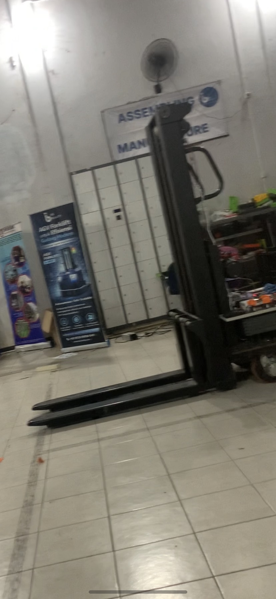
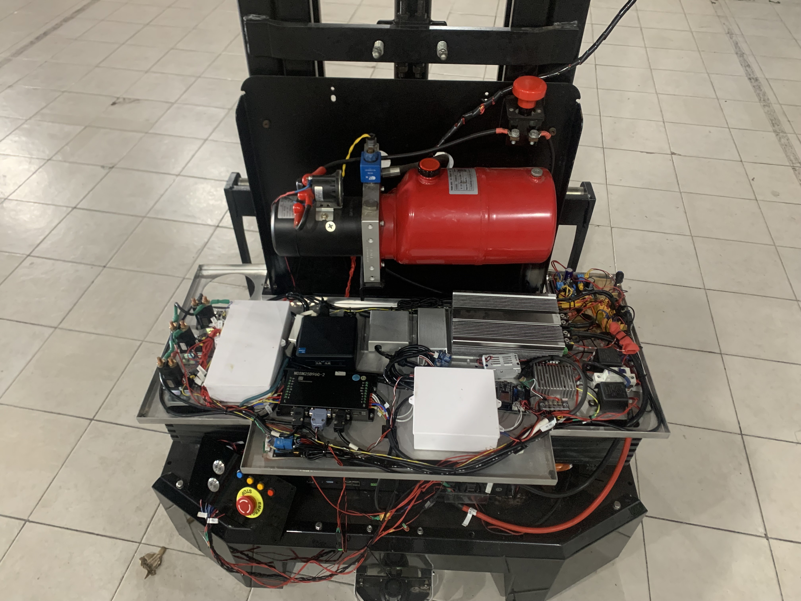
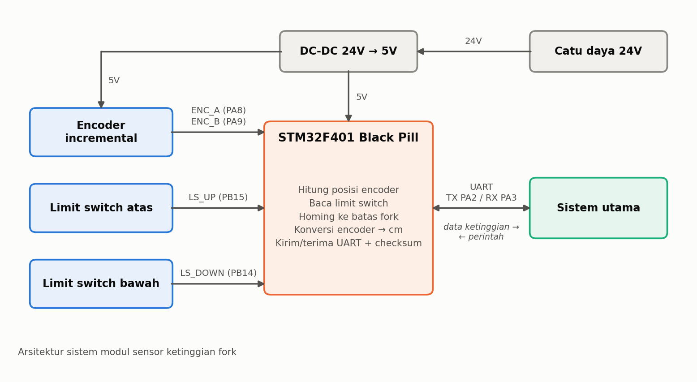
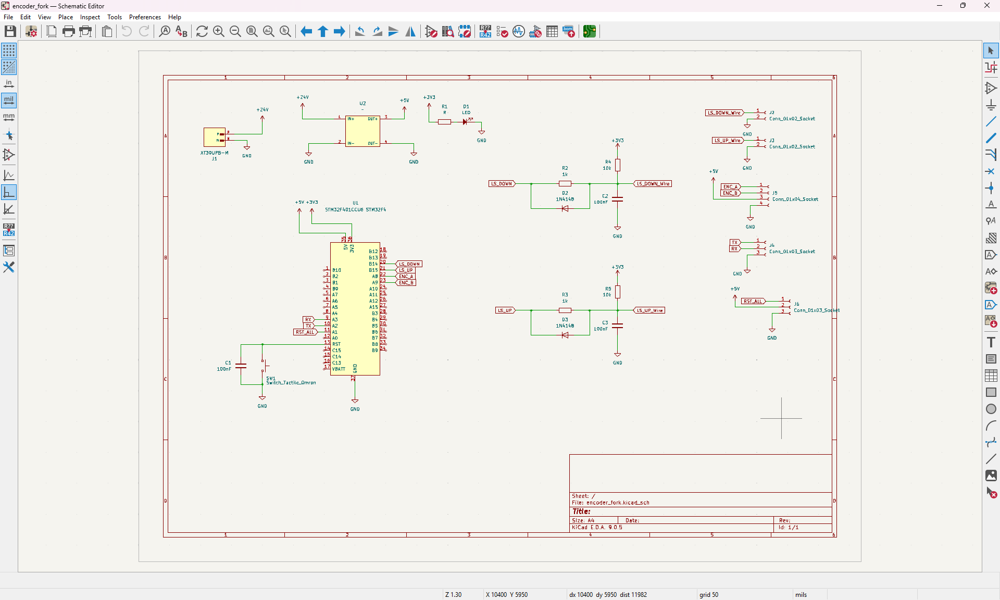
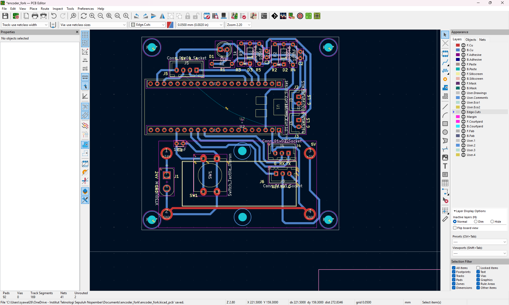
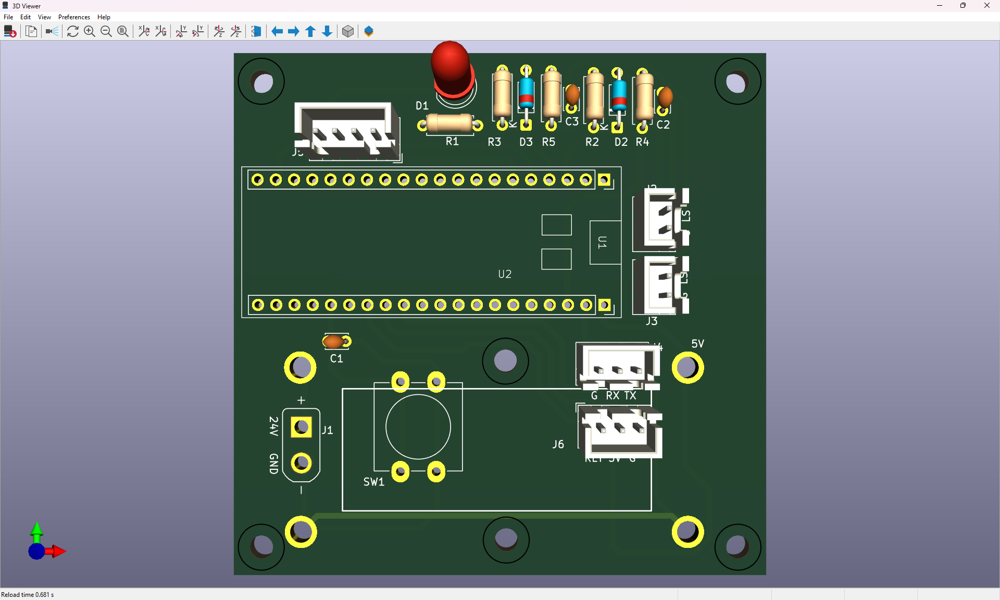
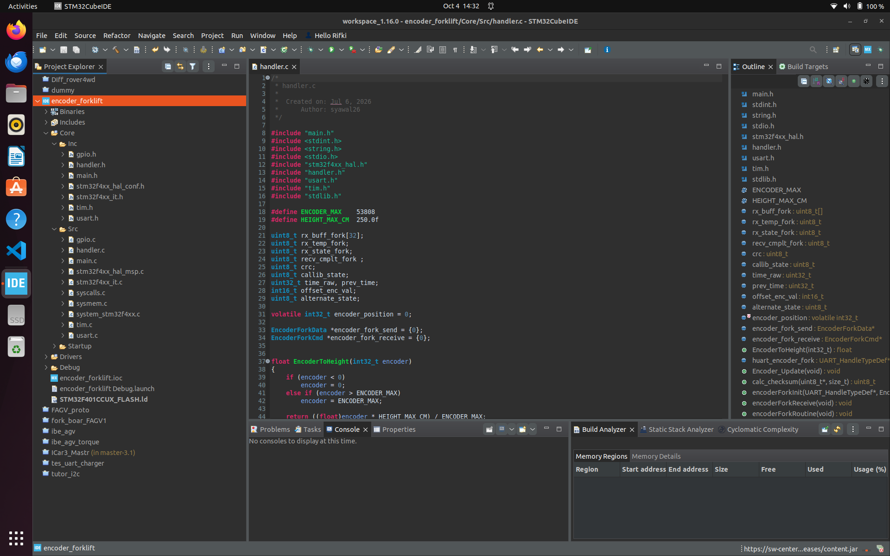

# PjBL Semester 7 — Week 1

**Pengembangan Sistem Navigasi Otonom dan Kendali Ketinggian Fork pada AMR Forklift Menggunakan ROS 2**
Mitra industri: PT Integrasi Bisnis Eksekutif

## Daftar Isi

- [Hasil Diskusi Proyek](#hasil-diskusi-proyek-dengan-pt-integrasi-bisnis-eksekutif)
- [Logbook Minggu 1](#logbook-minggu-1)
- [Nav2](#nav2)
- [RViz](#rviz)
- [Algoritma A*](#algoritma-a)
- [Modul Sensor Ketinggian Fork](#modul-sensor-ketinggian-fork)
- [Rencana Selanjutnya](#rencana-selanjutnya)
- [Referensi](#referensi)

---

## Hasil Diskusi Proyek dengan PT Integrasi Bisnis Eksekutif

Mitra memiliki forklift elektrik (pallet stacker) yang sudah dikembangkan pada semester sebelumnya. Forklift ini bisa dikendalikan dengan remote wireless, tetapi belum bisa berjalan otonom.

### Kondisi Saat Ini

- Kontroler = STM32
- Komunikasi = CAN bus
- Sensor = LiDAR 2D, IMU, encoder motor
- Mode kendali = Manual melalui remote wireless
- Fork hidrolik = Naik/turun manual, belum ada sensor ketinggian fork

### Permasalahan

- Forklift belum dapat bernavigasi secara otonom antar area kerja.
- Tinggi fork tidak terukur, sehingga tidak dapat dikendalikan ke posisi tertentu.

Kondisi tersebut membatasi penerapan forklift untuk proses *material handling* yang membutuhkan perpindahan otomatis antar area dan pengaturan tinggi fork sesuai tingkat rak.

### Lingkup Pengembangan

1. Sistem navigasi otonom menggunakan ROS 2 (SLAM + Nav2).
2. Instrumentasi dan kendali ketinggian fork.

### Dokumentasi

<table>
  <tr>
    <td align="center">
      <br>
      <sub>Pallet stacker forklift</sub>
    </td>
    <td align="center">
      <br>
      <sub>Hardware forklift: panel elektronik dan unit hidrolik</sub>
    </td>
  </tr>
</table>

---

## Logbook Minggu 1

Periode 28/09/2026 s.d. 02/10/2026, sesuai logbook individu DTEO ITS.

- Sen, 28/09 = Diskusi masalah dengan mitra di industri (2 jam); menyusun Project Charter (6 jam)
- Sel, 29/09 = Mempelajari Nav2 (4 jam); mempelajari RViz (3 jam)
- Rab, 30/09 = Membuat arsitektur sistem hardware pembaca ketinggian fork (4 jam); membuat skematik PCB (3 jam)
- Kam, 01/10 = Routing PCB (4 jam); mempersiapkan firmware pembaca ketinggian fork (3 jam)
- Jum, 02/10 = Mempelajari algoritma A* (8 jam)
- Total = 37 jam

**Target minggu ini:** merancang Project Charter serta mempelajari Nav2, SLAM, algoritma A*, Theta*, dan merancang arsitektur sistem untuk sensor ketinggian fork.

**Kendala:** belum mempelajari SLAM dan algoritma Theta*.

**Capaian target:** Sebagian.

---

## Nav2

**Nav2** adalah framework navigasi pada ROS 2 untuk membawa robot dari posisi awal ke posisi tujuan secara aman. Nav2 menangani localization, path planning, obstacle avoidance, dan *recovery* ketika robot terjebak.

### Komponen Utama

- `map_server` = Memuat peta (`.yaml` + `.pgm`)
- `amcl` = Localization robot pada peta menggunakan LiDAR (*particle filter*)
- `planner_server` = Membuat global path dari posisi robot ke goal
- `controller_server` = Mengikuti path dan menghasilkan velocity command (`/cmd_vel`)
- Costmap 2D (global & local) = Peta berisi nilai cost: area bebas dan obstacle
- `behavior_server` = Behavior *recovery*: spin, backup, wait
- `bt_navigator` = Mengatur alur navigasi menggunakan *Behavior Tree*
- `velocity_smoother` = Menghaluskan velocity command sebelum dikirim ke motor
- `lifecycle_manager` = Mengelola start/stop seluruh node Nav2

### Hasil Belajar

**Apa beda tugas planner dan controller?**

- Planner = Menghitung path yang aman berdasarkan global costmap
- Controller = Menghasilkan velocity command (`/cmd_vel`) untuk dijalankan hardware, mengikuti path dari planner

**Apa beda global costmap dan local costmap?**

- Global costmap = Berisi seluruh peta, dibangun dari peta hasil SLAM dan data sensor; dipakai planner
- Local costmap = Berisi area di sekitar robot dari data sensor saat itu; dipakai controller untuk menghindari obstacle yang baru muncul

**Contoh: ada orang lewat di depan robot**

- Yang pertama mendeteksi = Local costmap
- Yang bereaksi = Controller lebih dulu, lalu planner membuat path baru
- Kenapa controller lebih dulu = Karena controller bekerja dengan frekuensi lebih tinggi
- Kenapa planner juga bereaksi = Karena global costmap juga membaca data sensor, jadi orang itu ikut tercatat di global costmap

### Menjalankan Nav2

```bash
ros2 launch nav2_bringup bringup_launch.py \
  map:=$HOME/maps/area_kerja.yaml \
  params_file:=<path>/nav2_params.yaml \
  use_sim_time:=false
```

---

## RViz

**RViz2** adalah tool visualisasi 3D pada ROS 2 untuk menampilkan data sensor, TF tree, peta, dan path navigasi robot. RViz hanya menampilkan data, bukan simulator. Tool ini dipakai untuk memantau proses SLAM dan Nav2 serta melakukan debugging.

### Display yang Digunakan

- Map (`/map`) = Menampilkan peta hasil SLAM
- LaserScan (`/scan`) = Memeriksa data LiDAR
- TF = Memeriksa TF tree (`map`, `odom`, `base_link`, `laser`)
- RobotModel (`/robot_description`) = Menampilkan model forklift dari URDF
- Odometry (`/odom`) = Memeriksa hasil odometry
- Path (`/plan`) = Menampilkan global path dari Nav2
- Map costmap (`/global_costmap/costmap`, `/local_costmap/costmap`) = Menampilkan costmap Nav2

### Tool Interaktif

- **2D Pose Estimate**: memberikan initial pose robot ke AMCL (topic `/initialpose`).
- **Nav2 Goal**: mengirim goal navigasi ke Nav2.

### Menjalankan RViz

```bash
# RViz kosong
ros2 run rviz2 rviz2

# RViz dengan konfigurasi bawaan Nav2
ros2 launch nav2_bringup rviz_launch.py

# RViz dengan konfigurasi sendiri (File → Save Config As)
rviz2 -d config/forklift.rviz
```

---

## Algoritma A*

A* adalah algoritma untuk mencari path terpendek pada grid. Dijkstra mencari ke segala arah secara merata, sedangkan A* mendahulukan cell yang paling mengarah ke goal.

### Rumus

```
f = g + h
```

- `g` = Cost yang sudah ditempuh dari start ke cell ini
- `h` = Perkiraan cost dari cell ini ke goal (heuristic)
- `f` = Perkiraan total cost jika lewat cell ini

Untuk grid 4 arah (atas, bawah, kiri, kanan), `h` dihitung dengan Manhattan distance ke goal: `h = |selisih x| + |selisih y|`.

### Open List dan Closed List

- Open list = Cell yang sudah ditemukan tetapi belum di-expand
- Closed list = Cell yang sudah di-expand; tidak diperiksa lagi

Setiap langkah, A* mengambil cell dengan `f` terkecil dari open list, memindahkannya ke closed list, lalu memasukkan neighbor barunya ke open list. Pencarian berhenti saat goal diambil dari open list.

---

## Modul Sensor Ketinggian Fork

Modul ini membaca ketinggian fork menggunakan encoder dan 2 limit switch, dengan microcontroller STM32F401CCU6.

### Arsitektur Sistem



- Encoder incremental = Menghasilkan pulsa channel A dan B saat fork bergerak, untuk menghitung posisi dan arah gerak fork
- Limit switch (2 buah) = Penanda batas atas dan batas bawah fork, juga sebagai titik acuan saat homing
- STM32F401 Black Pill = Menghitung posisi encoder, mengubahnya menjadi ketinggian (cm), dan membaca kondisi limit switch
- UART = Jalur komunikasi dua arah ke sistem utama: data ketinggian dikirim ke sistem utama, perintah dari sistem utama diterima STM32, dengan checksum
- Sistem utama = Menerima data ketinggian fork dan mengirim perintah ke modul sensor fork

### Skematik

- Power supply = Input 24V (konektor XT30), diturunkan ke 5V dengan modul DC-DC (U2)
- Microcontroller = STM32F401CCU6 Black Pill (U1)
- Encoder = ENC_A (PA8) dan ENC_B (PA9) melalui konektor J5, dengan supply 5V
- Limit switch = LS_DOWN (PB14) dan LS_UP (PB15), masing-masing dengan pull-up 10k, resistor 1k, dioda 1N4148, dan kapasitor 100nF
- Komunikasi = UART TX (PA2) dan RX (PA3) melalui konektor J4
- Reset = Tombol SW1 ke pin NRST STM32; jalur RST_ALL (PA1) keluar melalui konektor J6
- Indikator = LED D1 pada jalur 3V3

> **Catatan minggu 2:** label limit switch pada skematik ini tertukar terhadap firmware yang berlaku (firmware: PB14 = batas atas, PB15 = batas bawah). Pemasangan mengikuti firmware; label skematik akan disesuaikan. Lihat [branch week2](https://github.com/syawxyz/PjBL-Semester7/tree/week2#rantai-konversi-pulsa-ke-ketinggian).



### PCB

- Software = KiCad 9.0.5
- Layer = 2 layer (F.Cu dan B.Cu)
- Status = Masih ada 2 koneksi yang belum di-routing





### Firmware

- IDE = STM32CubeIDE, project `encoder_forklift`
- File utama = `Core/Src/handler.c`
- Konversi = `EncoderToHeight()`: ketinggian = encoder × `HEIGHT_MAX_CM` / `ENCODER_MAX`, nilai encoder dibatasi 0 sampai `ENCODER_MAX`
- Konstanta di kode = `ENCODER_MAX` = 53808, `HEIGHT_MAX_CM` = 250 cm
- Komunikasi = UART (`huart_encoder_fork`) dengan checksum (`calc_checksum`)
- Fungsi lain = `Encoder_Update`, `encoderForkInit`, `encoderForkReceive`, `encoderForkRoutine`



---

## Rencana Selanjutnya

- Pembuatan PCB fork dan test firmware
- Mempelajari SLAM dan algoritma Theta* (materinya ada di [branch week2](https://github.com/syawxyz/PjBL-Semester7/tree/week2))
- Integrasi firmware MCU fork ke sistem utama dengan komunikasi UART

---

## Referensi

- [Dokumentasi Nav2](https://docs.nav2.org/)
- [Nav2 Quickstart (versi Rolling)](https://docs.nav2.org/rolling/getting_started/quickstart/quickstart/#quickstart)
- [Nav2 First-Time Robot Setup Guide](https://docs.nav2.org/setup_guides/index.html)
- [slam_toolbox](https://github.com/SteveMacenski/slam_toolbox)
- [robot_localization](https://github.com/cra-ros-pkg/robot_localization)
- [RViz2](https://github.com/ros2/rviz)
- [Dokumentasi ROS 2 Humble](https://docs.ros.org/en/humble/)
