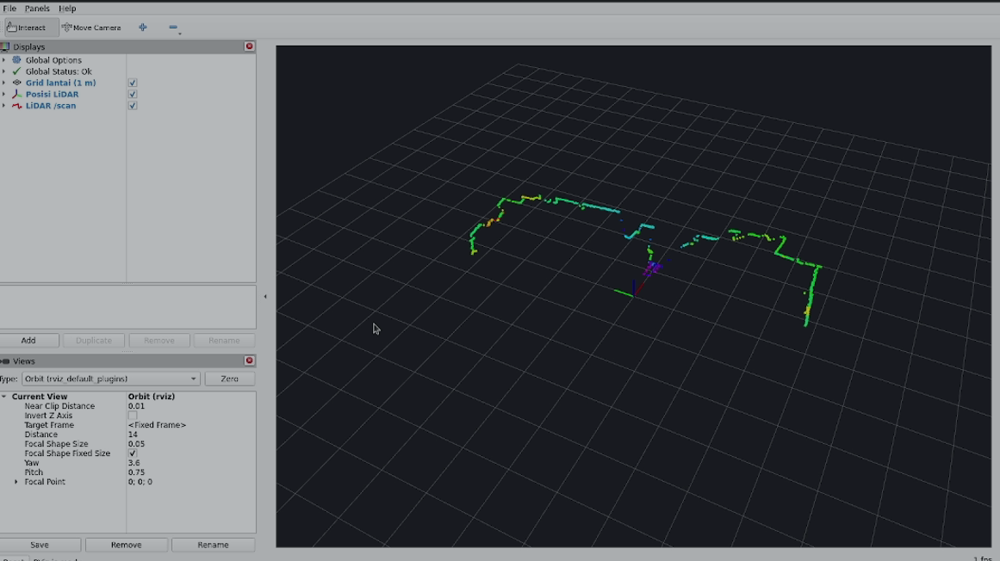

# PjBL Semester 7 — Week 5

**Pengembangan Sistem Navigasi Otonom dan Kendali Ketinggian Fork pada AMR Forklift Menggunakan ROS 2**
Mitra industri: PT Integrasi Bisnis Eksekutif

## Daftar Isi

- [Logbook Minggu 5](#logbook-minggu-5)
- [Video Demo](#video-demo)
- [Presentasi Ujian Progres](#presentasi-ujian-progres)
- [Referensi](#referensi)

---

## Logbook Minggu 5

Periode 26/10/2026 s.d. 30/10/2026 (tahap Perancangan, milestone M2 review desain), sesuai logbook individu DTEO ITS.

- Kam, 29/10 = Menyiapkan video demo: verifikasi bus CAN (candump, 250 kbps) dan LiDAR /scan di RViz langsung di forklift, tanpa menggerakkan forklift (2 jam, 16.00 s/d 18.00); menyiapkan presentasi ujian progres PjBL minggu 1 sampai 5 (2 jam, 18.00 s/d 20.00)
- Total = 4 jam

**Target minggu ini:** (1) review desain DED (M2) dan pengajuan Project Charter (M1); (2) pekerjaan lapangan: verifikasi frame CAN dengan candump, driver LiDAR (/scan), kalibrasi fork titik 200 cm dan arah turun, flash ulang firmware dengan watchdog paling lama 1 s; (3) laporan progres minggu 1 sampai 5.

Materi minggu sebelumnya:

- [Branch week1](https://github.com/syawxyz/PjBL-Semester7/tree/week1) = Diskusi dengan mitra, Nav2, RViz, algoritma A*, arsitektur dan skematik modul fork
- [Branch week2](https://github.com/syawxyz/PjBL-Semester7/tree/week2) = Simulasi Nav2 dan SLAM, Theta*, perakitan dan kalibrasi modul fork, CAN bus dasar dan CAN-bridge node, TF tree dan URDF, rosbag2
- [Branch week3](https://github.com/syawxyz/PjBL-Semester7/tree/week3) = CAN lanjutan dan data CAN forklift, FAST-LIO dan DLIO, Hybrid A*, desain kontrol forklift, draf DED bagian 01 sampai 03
- [Branch week4](https://github.com/syawxyz/PjBL-Semester7/tree/week4) = Driver LiDAR dan data /scan, DED bagian 04 sampai 10, flowchart, rencana pengujian, temuan desain

---

## Video Demo

Demo direkam langsung di forklift lewat remote ke PC onboard. Selama perekaman, forklift tidak digerakkan dan tidak ada perintah yang dikirim ke bus CAN; demo hanya membaca data.

### Verifikasi Bus CAN

Interface `can0` dijalankan pada 250 kbps, lalu traffic dibaca dengan `candump can0`. Frame dari IMU HWT901B, TPDO driver MDSM, dan telemetry STM32F407 terbaca bergantian dengan panjang data sesuai peta ID dari firmware. Hasil ini menjadi verifikasi awal format pesan CAN yang di minggu 3 hanya diambil dari kode firmware. Ringkasan isi frame ada di [Data CAN Forklift](https://github.com/syawxyz/PjBL-Semester7/tree/week3#data-can-forklift).

### LiDAR /scan di RViz

Driver LiDAR dijalankan dan topic `/scan` ditampilkan di RViz. Titik scan membentuk dinding dan rak di sekitar forklift.

---

## Presentasi Ujian Progres

Presentasi ujian progres PjBL minggu 1 sampai 5 berisi:

- Progres terhadap jadwal = Capaian tiap minggu dibandingkan dengan jadwal di Project Charter
- Demo = Video verifikasi bus CAN dan LiDAR /scan di atas
- Digitalisasi industri = Peran AMR forklift dalam proses material handling di gudang mitra
- Usulan judul PA = *Implementasi Hybrid A\* Shape-aware sebagai Path Planning pada Autonomous Mobile Robot Forklift untuk Menghasilkan Lintasan Aman di Ruang Gerak Terbatas*

---

## Referensi

- [SocketCAN (dokumentasi kernel Linux)](https://docs.kernel.org/networking/can.html)
- [can-utils](https://github.com/linux-can/can-utils)
- [RViz2](https://github.com/ros2/rviz)
- [Nav2 Smac Planner](https://docs.nav2.org/configuration/packages/configuring-smac-planner.html)
